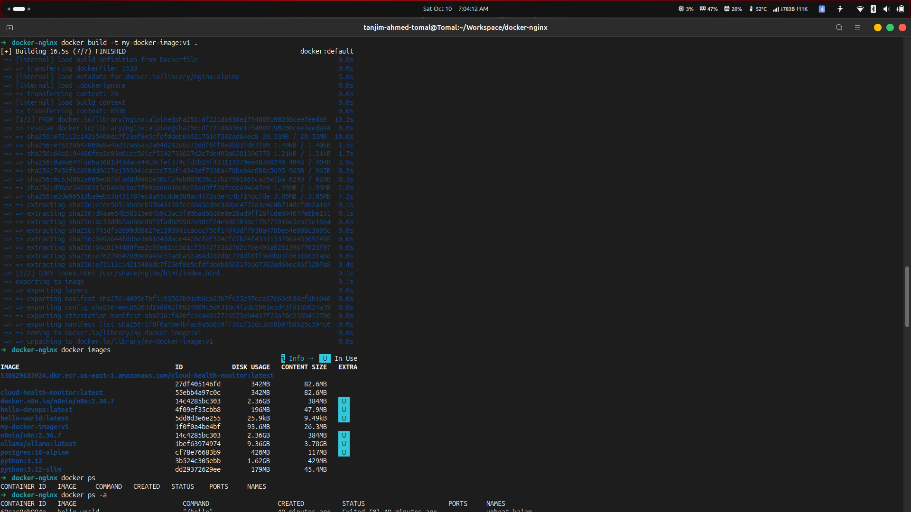
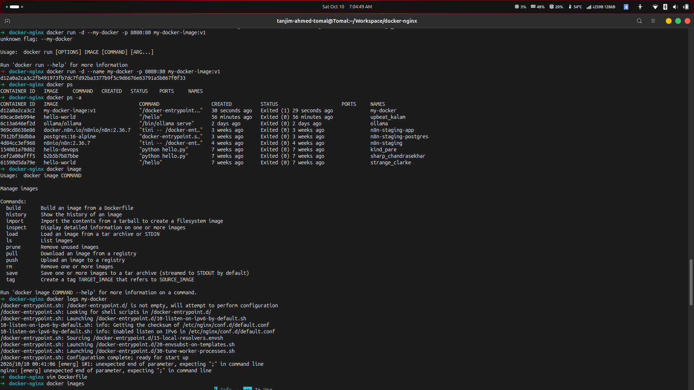
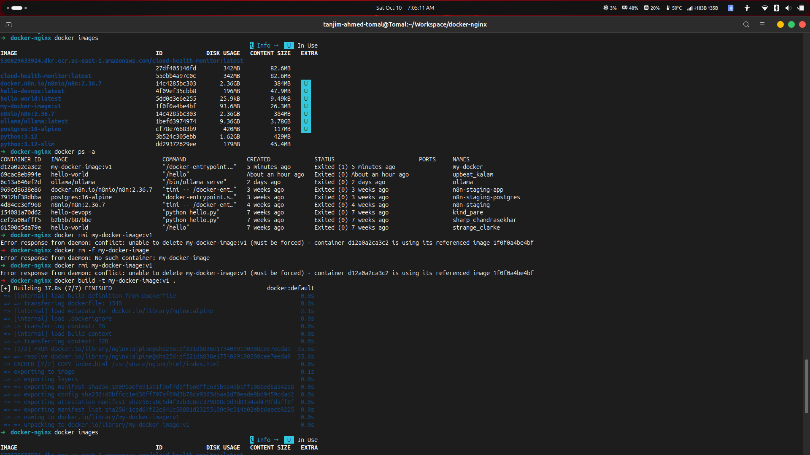
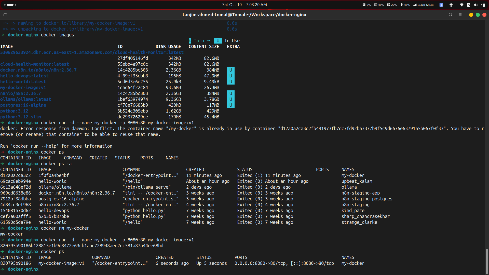

# Docker Nginx Web Server

[](https://www.docker.com/)
[](https://nginx.org/)
[](https://github.com/tanahmeeedsx/docker-nginx)

A hands-on Docker project demonstrating how to build a custom Docker image using Nginx, serve a custom HTML webpage, and run the container with port mapping.

## Project Overview

This project uses the official `nginx:alpine` image as its base and copies a custom `index.html` file into the Nginx web root. The resulting Docker image is used to launch a container that serves the webpage on port `8080` of the host machine.

## Technologies Used

- Docker
- Nginx
- Alpine Linux
- HTML
- Linux CLI

## Project Structure

```text
docker-nginx/
├── Dockerfile
├── index.html
├── README.md
└── screenshots/
    ├── 01-docker-build.png
    ├── 02-docker-run.png
    ├── 03-docker-images.png
    ├── 04-running-container.png
    └── 05-nginx-page.png
```

## Implementation Steps

### 1. Create the Dockerfile

The Dockerfile defines the base image and copies the custom webpage into the directory served by Nginx.

```dockerfile
FROM nginx:alpine

COPY index.html /usr/share/nginx/html/index.html
```

### 2. Build the Docker Image

Build a custom image named `my-docker-image` with the version tag `v1`.

```bash
docker build -t my-docker-image:v1 .
```



### 3. Run the Container

Start the Nginx container in detached mode and map host port `8080` to container port `80`.

```bash
docker run -d --name my-docker -p 8080:80 my-docker-image:v1
```



### 4. Verify the Docker Image

List the locally available Docker images and confirm that the custom image was created successfully.

```bash
docker images
```



### 5. Verify the Running Container

Check the container's status and port mapping.

```bash
docker ps
```

The container should display an `Up` status and a port mapping similar to `0.0.0.0:8080->80/tcp`.



### 6. Access the Nginx Webpage

Open the following URL in a browser to access the custom webpage served by the Nginx container.

**URL:** http://localhost:8080


## Key Learnings

- Writing a Dockerfile to create a custom image.
- Building and tagging Docker images.
- Running containers in detached mode.
- Mapping host ports to container ports.
- Inspecting images and checking container status.
- Serving static HTML content using Nginx.
- Troubleshooting stopped containers and container naming conflicts.

## Useful Docker Commands

| Command | Purpose |
|---|---|
| `docker images` | List local images |
| `docker ps` | List running containers |
| `docker ps -a` | List all containers |
| `docker logs my-docker` | View container logs |
| `docker stop my-docker` | Stop the container |
| `docker start my-docker` | Start an existing container |
| `docker rm my-docker` | Remove a stopped container |

## Author

**Tanjim Ahmed (Tomal)**

- GitHub: [@tanahmeeedsx](https://github.com/tanahmeeedsx)

---

This project was created as part of my hands-on learning journey in Docker, Linux, and DevOps fundamentals.
