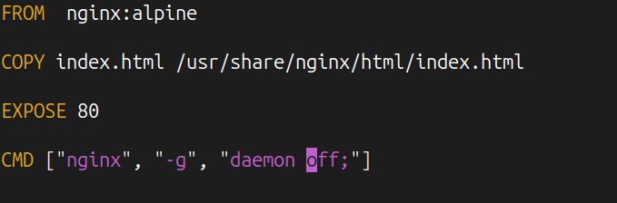
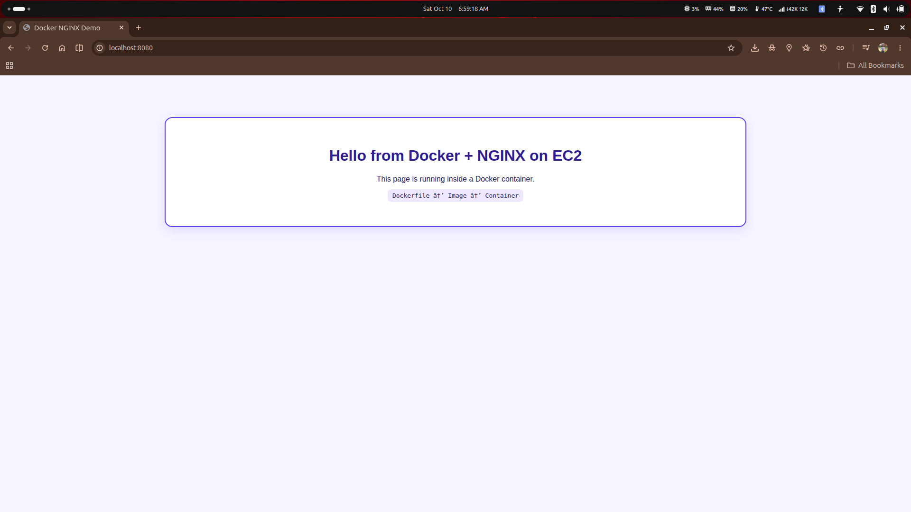

#  Docker Nginx Web Server

<p align="center">
  
</p>

<p align="center">
  <strong>Build. Containerize. Deploy.</strong>
  <br/>
  A hands-on project demonstrating how to build a custom Docker image and serve a static website using Nginx.
</p>

<p align="center">
  
  
  
  
</p>

---

## Project Overview

This project demonstrates how to containerize a custom HTML webpage using Docker and serve it through an Nginx web server.

Using the official `nginx:alpine` base image, I created a custom Docker image by copying an `index.html` file into Nginx's default web directory. I then launched a container and mapped host port `8080` to container port `80` to access the webpage through a browser.

## Technologies Used

<p>
  
  
  
  
</p>

- **Docker:** Image creation and container management
- **Nginx:** Web server for serving static content
- **Alpine Linux:** Lightweight base image
- **HTML:** Custom webpage content
- **Linux CLI:** Project setup and command-line operations

## Project Architecture

```text
                 Dockerfile + index.html
                           |
                           v
                  Docker Image Build
                           |
                           v
                 my-docker-image:v1
                           |
                           v
                    Docker Container
                       my-docker
                           |
                           v
                   Nginx Web Server
                     Container :80
                           |
                     Port Mapping
                      Host :8080
                           |
                           v
                  http://localhost:8080
```

## Project Structure

```text
docker-nginx/
├── Dockerfile
├── index.html
├── README.md
└── screenshots/
    ├── 01-docker-build.png
    ├── 02-docker-run.png
    ├── 03-docker-images.png
    ├── 04-running-container.png
    ├── 05-Dockerfile.png
    └── 06-nginx-page.png
```

## Implementation and Screenshots

### 1. Build the Docker Image

Created a custom image using the `Dockerfile` and tagged it as `my-docker-image:v1`.

```bash
docker build -t my-docker-image:v1 .
```


### 2. Run the Docker Container

Started the container in detached mode and mapped host port `8080` to Nginx's container port `80`.

```bash
docker run -d --name my-docker -p 8080:80 my-docker-image:v1
```


### 3. Verify the Docker Image

Listed the locally available images to verify that the custom image was created.

```bash
docker images
```


### 4. Verify the Running Container

Checked the container status and port mapping.

```bash
docker ps
```

The container should show an `Up` status and a port mapping similar to `0.0.0.0:8080->80/tcp`.


### 5. Dockerfile Configuration

Reviewed the Dockerfile used to build the custom Nginx image.

```dockerfile
FROM nginx:alpine

COPY index.html /usr/share/nginx/html/index.html
```



### 6. Access the Nginx Webpage

Opened the webpage served by the running container in a browser.

**Local URL:** [http://localhost:8080](http://localhost:8080)



## Useful Docker Commands

| Command | Description |
|---|---|
| `docker build -t my-docker-image:v1 .` | Build a custom image |
| `docker images` | List Docker images |
| `docker run -d --name my-docker -p 8080:80 my-docker-image:v1` | Create and start a container |
| `docker ps` | Show running containers |
| `docker ps -a` | Show all containers |
| `docker logs my-docker` | View container logs |
| `docker stop my-docker` | Stop the container |
| `docker start my-docker` | Start an existing container |
| `docker rm my-docker` | Remove a stopped container |

## Key Learnings

- Writing a Dockerfile using an official base image.
- Building and tagging custom Docker images.
- Running containers in detached mode.
- Understanding host-to-container port mapping.
- Verifying container status and inspecting logs.
- Serving static HTML content using Nginx.
- Troubleshooting container startup errors and naming conflicts.

## Author

**Tanjim Ahmed (Tomal)**

[GitHub](https://github.com/tanahmeeedsx) · [LinkedIn](https://www.linkedin.com/in/tanahmedd/)

---

<p align="center">
  Built as part of my hands-on learning journey in Docker, Linux, and DevOps.
</p>
