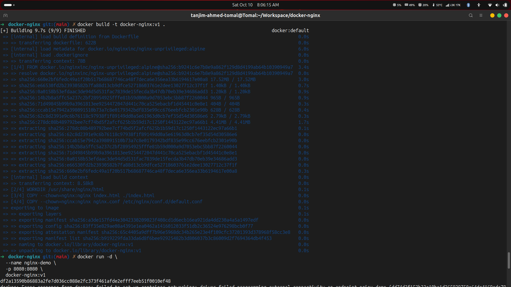
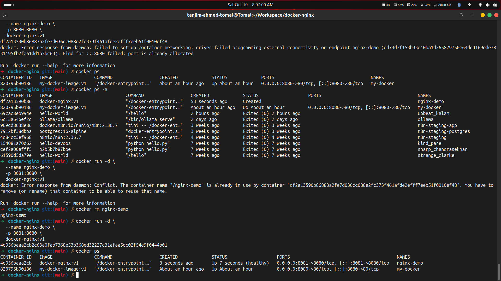
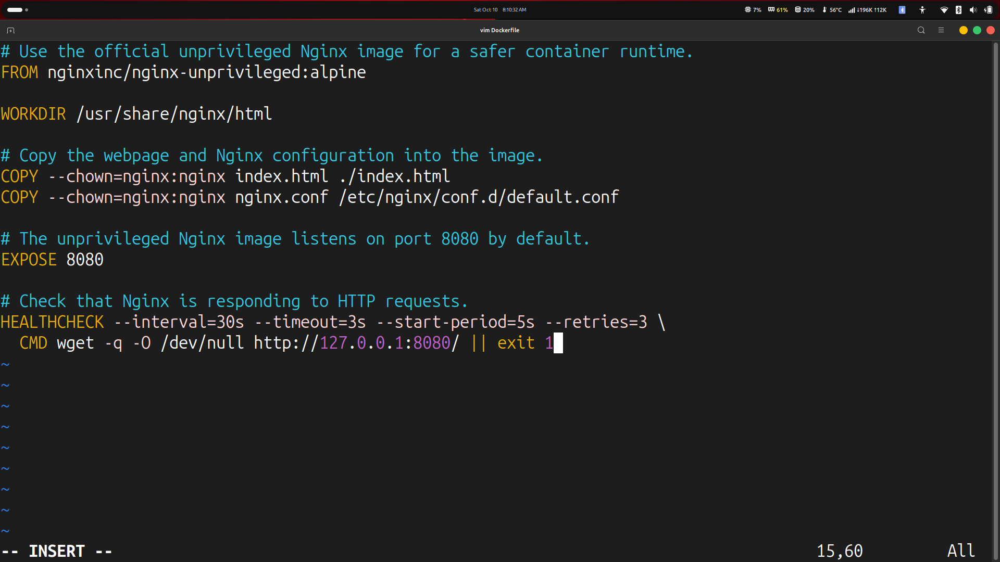

#  Docker Nginx Web Server

<p align="center">
  
</p>

<p align="center">
  <strong>Build. Containerize. Deploy.</strong>
  <br/>
  A hands-on project demonstrating how to build a custom Docker image, configure Nginx, and serve a static website using a container.
</p>

<p align="center">
  
  
  
  
</p>

---

## Project Overview

This project demonstrates how to containerize a custom HTML webpage using Docker and serve it through an Nginx web server.

I created a custom Docker image named `docker-nginx:v1`, configured Nginx using `nginx.conf`, and ran the application inside a container named `nginx-demo`. The container uses host port `8081` mapped to container port `8080`, making the webpage accessible through a browser.

## Technologies Used

<p>
  
  
  
  
</p>

- **Docker:** Image creation and container management
- **Nginx:** Web server for serving static content
- **HTML5:** Custom webpage content
- **Nginx Configuration:** Custom server configuration through `nginx.conf`
- **Linux CLI:** Project setup, container management, and troubleshooting

## Project Architecture

```text
             Dockerfile + index.html
                      |
                      v
              Nginx Configuration
                 nginx.conf
                      |
                      v
                Docker Image
              docker-nginx:v1
                      |
                      v
               Docker Container
                  nginx-demo
                      |
                      v
               Nginx Web Server
                Container :8080
                      |
                Port Mapping
                 Host :8081
                      |
                      v
             http://localhost:8081
```

## Project Structure

```text
docker-nginx/
├── Dockerfile
├── index.html
├── nginx.conf
├── README.md
└── screenshots/
    ├── 01-docker-setup.png
    ├── 02-container-run.png
    ├── 03-container-status.png
    └── 04-nginx-webpage.png
```

## Implementation and Screenshots

### 1. Docker Setup and Image Build

Configured the project files and built a custom Docker image named `docker-nginx:v1`.

```bash
docker build -t docker-nginx:v1 .
```



### 2. Run the Docker Container

Started the container in detached mode and mapped host port `8081` to the Nginx container port `8080`.

```bash
docker run -d \
  --name nginx-demo \
  -p 8081:8080 \
  docker-nginx:v1
```



### 3. Dockerfile Configuration


### 4. Access the Nginx Webpage

**Local URL:** http://localhost:8081



## Useful Docker Commands

| Command | Description |
|---|---|
| `docker build -t docker-nginx:v1 .` | Build a custom Docker image |
| `docker images` | List available Docker images |
| `docker run -d --name nginx-demo -p 8081:8080 docker-nginx:v1` | Create and start a container |
| `docker ps` | Show running containers |
| `docker ps -a` | Show all containers |
| `docker logs nginx-demo` | View container logs |
| `docker inspect nginx-demo` | Inspect container configuration and status |
| `docker stop nginx-demo` | Stop the container |
| `docker start nginx-demo` | Start an existing container |
| `docker rm nginx-demo` | Remove a stopped container |

## Key Learnings

- Writing a Dockerfile to build a custom image.
- Configuring Nginx for a containerized web server.
- Building and tagging Docker images.
- Running containers in detached mode.
- Understanding host-to-container port mapping.
- Verifying container health and inspecting logs.
- Serving a custom HTML webpage using Nginx.
- Troubleshooting container startup errors and naming conflicts.

## Author

**Tanjim Ahmed (Tomal)**

[GitHub](https://github.com/tanahmeeedsx) · [LinkedIn](https://www.linkedin.com/in/tanahmedd/)

---

<p align="center">
  Built as part of my hands-on learning journey in Docker, Linux, and DevOps.
</p>
